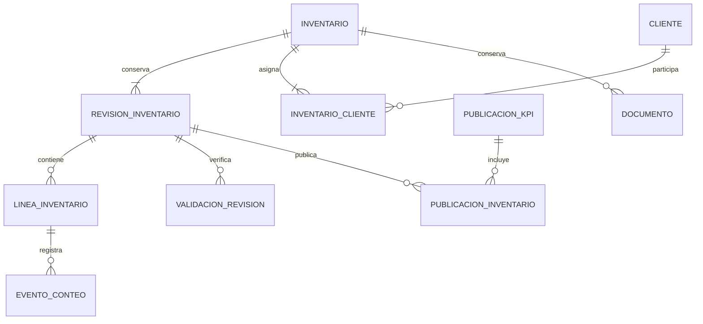
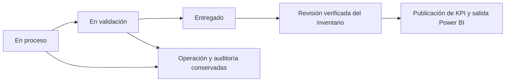

# Modelo operativo y preservación de históricos de Centro de Mando

Propuesta del 29 de octubre de 2026. Se basa en el código de la candidata y el libro actualizado recibidos. Está pendiente revisar las fuentes inventarios_uio e Interfaz antes de cerrar el modelo de operación y la equivalencia WMS. No se ha cambiado el servidor ni el sistema en producción.

## Decisiones y hechos confirmados

- Google Sheets INVENTARIOS es la fuente actual del inventario consolidado; Supabase no está al día ni debe actualizarse como requisito.
- Cada fila de PANEL DE CONTROL referencia un archivo de inventario independiente. En el corte hay 363 filas, 363 IDs de Drive distintos, 348 Entregado y 15 En Proceso.
- El snapshot de consolidación seleccionó 348 fuentes entregadas. Los 347 orígenes físicos presentes en INVENTARIOS y los 334 de REGISTRO están todos dentro de ese conjunto. Ningún origen de los 15 pendientes está en esas hojas consolidadas.
- No todos los entregados aportan filas: puede haber una copia excluida u hojas vacías. El catálogo debe conservar siempre sus metadatos y el motivo; no confundir ausencia del consolidado con archivo inexistente.
- MySQL es el destino de las operaciones y de sus datos. Drive puede mantenerse durante la transición para documentos históricos y enlaces ya utilizados por clientes.

## 1. Modelo de datos: separar operación, evidencia y publicación

La optimización viene de compartir entidades, evitar copias repetidas de código/datos, usar índices y leer incrementos. El número de pestañas no determina el número final de tablas. No se crea una tabla ni una base por archivo o por cliente.

| Área | Entidades propuestas | Función |
|---|---|---|
| Organización | pais, sede, cliente, cliente_sede | Identidades y códigos ERP, zona horaria, alias revisados y separación UIO/GYE |
| Inventarios | inventario, inventario_cliente, referencia_externa | Una entidad por archivo/conteo, sus clientes y su ID Drive original |
| Revisiones | revision_inventario, linea_inventario | Versiones de stock/resultado y filas con IDs internos propios |
| Operación WMS | sesion_conteo, evento_conteo, ajuste | Conteos/reconteos y ajustes con actor, fecha y trazabilidad |
| Validación | validacion_revision, incidencia | Resultado de reglas, motivos y aprobación ligada a una revisión concreta |
| Publicación | publicacion_kpi, publicacion_inventario, publicacion_activa | Corte coherente de revisiones entregadas; activación transaccional |
| Acceso | usuario, rol, permiso, usuario_sede, usuario_cliente | Autorización de operarios, jefaturas, auditores y clientes externos |
| Documentos | documento, documento_cliente, plantilla_version | Históricos Drive/servidor, reportes por cliente y formato versionado |
| Planificación | evento_cronograma, asignacion_equipo, codigo_programado | Sustituye hojas de cronograma, equipos de tarea y programación SKU/ABC |
| Auditoría y trabajos | evento_auditoria, trabajo, ejecucion_trabajo | Logs, progreso, reintentos y tareas programadas con retención definida |

El esquema anterior es una propuesta de dominio, no DDL final. El código existente bajo enterprise/sql conserva una copia de staging: no es la base de operación definitiva.

Identidades a respetar:

- Código visible: conservar nombres como 260406_FLUKE y el formato actual de nuevas creaciones. No imponer unicidad por código: IBM y VENTURA pueden tener dos inventarios distintos bajo el mismo código.
- ID interno: propio y estable por inventario; las referencias Drive siguen como trazabilidad. Si un ID Drive se repite en el panel, se registra la incidencia para evitar importar dos veces el mismo archivo; no se inventa un conteo nuevo silenciosamente.
- Línea: ID interno por fila/versión. SKU, serie y N de línea no son claves únicas universales. Hay numeraciones vacías/fraccionarias y series/logística diferentes con la misma numeración.
- Reintento: identificador de petición para la operación y snapshot+hoja+fila para importar un corte inmutable. Las posiciones de una hoja editable no identifican por sí solas una operación futura.
- Valores: conservar originales y errores de tipo en staging; los campos operativos se convierten con validación y precisión definida desde la fuente y el WMS, sin convertir texto inválido a cero.

Actualización de identidad histórica: una reutilización operacional confirmada puede dejar varios códigos válidos dentro de un archivo físico. La política explícita v4 del [traslado histórico](../enterprise/TRASLADO_HISTORICO.md) separa esos conteos por origen + código, conservando todas las líneas y su procedencia común. Requiere códigos y cantidades completos aprobados; no convierte automáticamente cualquier mezcla en varios inventarios. La nomenclatura confirmada es `DDMMAA_CLIENTE`; se conserva literalmente y las fechas originales no se sustituyen por fechas inferidas del código.

## 2. Solo Entregado forma parte del consolidado

La persistencia del inventario es independiente de su elegibilidad para KPI. Se importan y conservan todos los estados.

- En Proceso / En Validación: guardar stock, conteos, participantes, eventos, fechas y observaciones. Excluirlos de la nueva publicación de KPI final.
- Entregado: seleccionar la revisión cerrada que cumple las validaciones actuales. No añadir una confirmación manual nueva a los operarios como parte de esta propuesta; se reproduce el cierre/validación real que se verifique en Interfaz.
- Reapertura autorizada: registrar una revisión nueva y el cambio de estado; conservar el corte ya publicado como evidencia histórica. La publicación nueva no incorpora el trabajo pendiente hasta que vuelva a estar entregado y validado.
- Archivado es una condición de conservación/visualización, no un reemplazo de Entregado: un entregado antiguo puede seguir en el histórico y en consultas por período.
- Activar cada publicación completa en una transacción, no mediante DELETE seguido de inserciones visibles por partes. Presentar fecha/corte de actualización y separar progreso operativo de resultado oficial.

Hallazgo del código: la selección utilizaba una búsqueda de la palabra entregado dentro del texto. Esto aceptaría No entregado y Entregado pendiente de validación. La candidata ahora compara el estado completo y tiene pruebas del núcleo real que confirman exclusión sin tocar las planillas hijas. No se publicaron estos cambios en Google.

La lista de una corrida es un snapshot al inicio. Si el estado cambia durante el procesamiento, ese corte conserva la referencia inicial; la implementación nueva debe comprobar la revisión/estado elegible al activar el corte y evitar publicar una revisión reabierta. No presentar una mezcla temporal de estados como el último resultado validado.

## 3. Los 15 archivos pendientes necesitan una extracción propia

El libro maestro contiene sus metadatos, pero no acredita que contenga sus planillas operativas ni sus conteos actuales. Por eso, migrar únicamente INVENTARIOS/REGISTRO perdería la capacidad de continuar esos trabajos.

Se generó un catálogo de 363 fuentes y una lista de las 15 pendientes, con fila del panel, estado, sede y enlace original. Son listas de origen, no copias completas de esos archivos.

Antes del cambio de sistema:

1. Leer cada fuente hija autorizada, incluidas sus pestañas, stock, conteos, ajustes, registros y metadatos de informe; recuperar las fuentes entregadas cuando el detalle de formato/histórico no esté en el consolidado.
2. Preservar el documento original y el ID de Drive, con fecha, hash y resultado de extracción. No deducir cliente/sede automáticamente de un sufijo.
3. Cargar todos los inventarios al catálogo y conservar en curso sus estados y eventos. Los que no se puedan leer quedan identificados como pendiente de extracción; no se omiten del informe de integridad.
4. Hacer un corte inicial mientras Google sigue siendo el escritor y comparar los cambios posteriores. El mismo trabajo no debe recibir escrituras de dos sistemas simultáneamente.
5. Conciliar por inventario y por cliente, no solo totales globales; verificar explícitamente los 15 pendientes antes de trasladar a sus operarios.

## 4. Plantilla y terminal WMS en el servidor

inventarios_uio pasa a ser la referencia de una plantilla versionada: campos, etiquetas, orden de columnas, cálculos, formatos, gráficos y hojas de exportación. El formato para los operarios se reproduce en la aplicación y el XLSX/PDF de salida conserva los encabezados convenidos.

Interfaz pasa a ser el módulo WMS común. El inventario se abre por su ID interno, por ejemplo `/inventarios/{id}`, con el código visible, cliente, sede, participantes, estado y versión de plantilla. No se duplica el código del WMS para cada archivo.

El código recibido confirma un WMS standalone mediante `_obtenerWmsUrl()` y `WMS_DEPLOY_URL`, además del HTML del Centro de Mando. El ZIP maestro no demuestra que contenga la versión realmente desplegada de ese proyecto independiente. Los enlaces identifican los proyectos, pero el XLSX no incluye el código Apps Script: se necesitan también las fuentes del script de plantilla e Interfaz para comprobar la equivalencia.

Reproducir y probar antes de activar:

- Escaneo/búsqueda de SKU y serie, ubicación, lote, despacho y partida.
- Conteo ciego y visibilidad de cantidades por rol, rondas/reconteos, validación y ajustes.
- Multiplicidad legítima; regla de serie/cantidad y tratamiento de cantidades cero/decimales según el WMS real.
- Guardado transaccional e idempotente; control de versión para no sobreescribir cambios de otro operador.
- Pausa, reapertura autorizada, entrega y validación, historial de acciones y trabajo después de una desconexión según los flujos existentes.
- Auditores internos/externos con permisos comprobados en servidor; un parámetro rol en una URL no concede autorización.

## 5. Históricos de cliente y uso de Drive

Recomendación para la transición:

- Mantener los archivos históricos actuales en Drive y conservar sus enlaces y permisos. No moverlos ni sustituirlos durante la validación del nuevo sistema.
- Mantener MySQL como origen de datos del portal y la operación nueva. Guardar referencias Drive como documentos históricos, no consultar cientos de hojas de Google para cada apertura del panel.
- Ofrecer un portal de cliente con su cuenta, inventarios y cortes aprobados, filtros por fecha/estado e informes descargables. Los datos en curso pueden mostrarse solo cuando el permiso y la política lo autoricen, identificados como provisionales y separados del KPI final.
- Las versiones pasadas que no estén disponibles en las fuentes no se pueden reconstruir desde el último estado; se importan documentos y revisiones realmente existentes, sin crear cortes históricos ficticios. Cada reporte oficial referencia revisión, publicación y versión de plantilla. El cliente puede consultar el último resultado y los cortes anteriores; una actualización diaria no sobrescribe sin trazabilidad el informe de cierre histórico.
- Si se necesita retirar Drive por completo, copiar los documentos al almacenamiento privado del servidor o repositorio empresarial, verificar su integridad y reproducir el acceso antes de retirar los originales. No borrar Drive como efecto de una importación SQL.

Un inventario multi-cliente exige filtrar líneas, métricas y exportaciones por el cliente autorizado. Ser lector de un archivo que combina clientes no debe revelar las cuentas de los demás. Las líneas sin cliente identificado quedan en revisión interna, conservadas; no se asignan a un cliente externo por inferencia. Los documentos históricos existentes requieren revisar sus permisos antes de mostrarlos automáticamente desde el portal.

Los archivos privados se entregan por una ruta autenticada con comprobación de cliente/inventario. No exponer una carpeta de documentos directamente mediante un alias público de Apache.

## 6. Optimización y almacenamiento

- Índices propuestos según consultas: inventario(sede, estado, fecha), inventario_cliente(cliente, inventario), linea_inventario(revision, sku), linea_inventario(revision, posicion), evento_conteo(linea, fecha, id), documento(cliente/inventario, fecha). Confirmar con EXPLAIN y carga real.
- Paginar por clave estable y consultar solo la revisión requerida. No cargar todo el histórico de inventarios en cada refresco del calendario.
- Reportes y KPI por publicación, con caché por cliente, permisos y corte; nunca una caché general que pueda mezclar cuentas.
- Sustituir cache/snapshot técnico, identidades y varios logs de Sheets por trabajos/auditoría con relaciones y retención definida. Mantener un respaldo previo a cualquier depuración.
- Histórico online en MySQL por cliente/fecha e informes originales en almacenamiento de documentos. El volumen actual no justifica particionar o fragmentar por cliente a ciegas; medir antes.
- El primer paquete bruto conserva las 19 hojas para no perder evidencia, pero no es el modelo permanente. El paquete local ocupa unos 267 MiB; conservar uno completo cada día sumaría aproximadamente 95 GiB/año, por encima del disco libre actual. Usar una carga base, incrementos y respaldos/retención coordinados; retirar temporales solo después de conciliación y copia verificada fuera del servidor.
- Usar un proceso, base y usuarios propios de Centro de Mando, pool acotado y trabajos por lotes. No cambiar parámetros globales MySQL ni servicios vecinos para acelerar una importación.

## 7. Infraestructura y aislamiento

La comprobación enviada por el usuario no muestra escucha ni referencias para 3003/8445. UFW aparece inactivo. Hay 50 GB de disco libre y aproximadamente 9,2 GiB de RAM disponible; la memoria libre baja incluye caché recuperable y no representa por sí sola falta de RAM.

Propuesta: `https://apps.flexnetuio.com:8445/` en un vhost Apache independiente, hacia `127.0.0.1:3003`. Falta comprobar el firewall/NAT externo cuando exista un servicio de prueba. UFW inactivo no acredita toda la ruta de acceso.

Preservar 8443→3002 (IV_ITSANET), 8444→8010 (RRHH), 80/443→8080 (Data Sync), sus configuraciones y las bases actuales. No activar nuevas reglas de firewall ni recargar Apache durante esta fase de análisis.

Como los puertos comparten hostname, los cookies no están aislados por puerto: utilizar un nombre de sesión exclusivo, por ejemplo `__Host-ims_cm_session`, HttpOnly/Secure y validación de origen/CSRF que incluya el puerto. Esto evita interferir con sesiones de otras aplicaciones; no reutilizar su cookie ni su base de usuarios por compartir servidor. CORS y permisos se resuelven en el backend nuevo, sin tokens comunes de acceso a todas las cuentas.

## Criterio de finalización

La migración estará lista cuando fuentes hijas y proyectos dependientes estén inventariados, los 15 pendientes puedan continuar, los clientes solo vean sus cuentas, el WMS reproduzca sus reglas y formatos, los KPI seleccionen solo Entregado, los contratos Power BI 30/15 estén conciliados y se haya ensayado un corte/reversión que conserve nuevas operaciones. Mantener Google como escritor hasta ese momento.

## Dependencias identificadas con los enlaces del usuario

- INVENTARIOS_UIO: https://docs.google.com/spreadsheets/d/1Y2VZpr-fy6iuZyfX-96N1r9l3WdZOBfFnEV6Y2BHWog/edit. Coincide con CONFIG.TEMPLATE_ID del código recibido.
- INTERFAZ: https://docs.google.com/spreadsheets/d/1DTNYkDGdkTbMsAyUa2xeaMeY3zgk77cgua0Gd7_rJSk/edit.
- WMS activo: https://script.google.com/a/macros/itsanet.com/s/AKfycbwBwuTEaaxpf3IWWt1iAT0DzI8QIqZSXm2SnA1otqttURsUi2mEwnvNU1a1xn-vu2N2/exec. Coincide con el despliegue standalone de referencia en el código.

El usuario confirma que los libros admiten lectores con vínculo. Se intentó descargarlos con conexión normal y con ejecución autorizada fuera del sandbox; ambos libros y la página WMS fallaron por conectividad (URLError), sin obtener una respuesta de Google que permita atribuir el problema a sus permisos. No se ha inspeccionado su contenido y no se debe afirmar que sus fórmulas o su código ya son equivalentes.

Para revisar formatos se necesitan los XLSX de ambos libros como adjuntos. Para revisar la lógica se necesitan las fuentes de Apps Script: el ID de hoja, el ID de implementación /exec y el ID de proyecto de Apps Script son distintos. El ZIP de Interfaz debe corresponder al proyecto que contiene la implementación activa; la descarga XLSX no incluye el código Apps Script.
