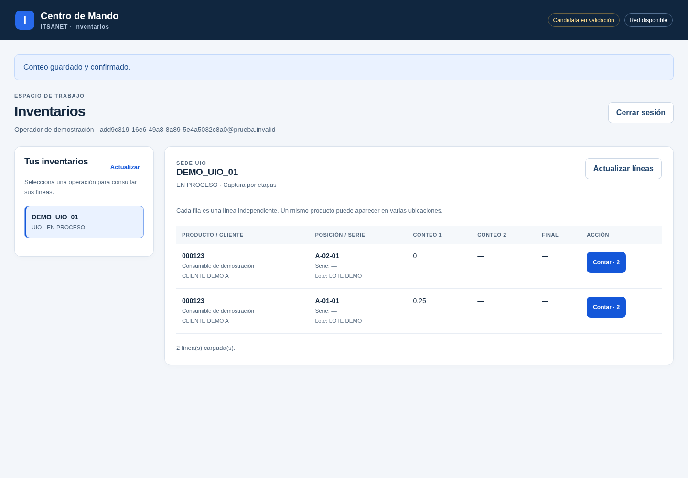
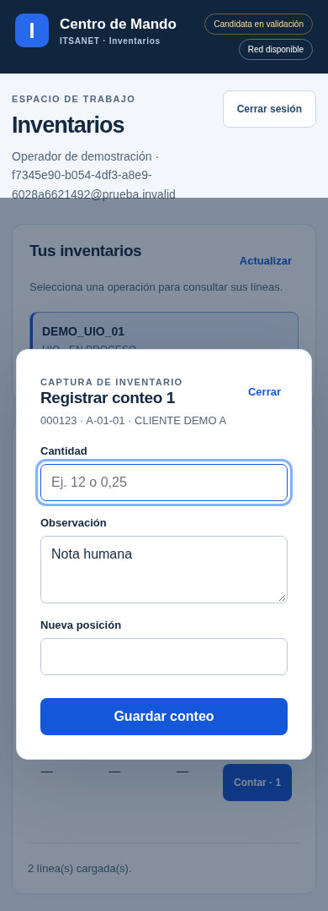

# Interfaz candidata — 6 de noviembre de 2026

Pantallas conectadas a la API y MySQL del núcleo candidato. Las imágenes y las pruebas usan **datos sintéticos**, no inventarios reales migrados. La aplicación actual, sus operadores y WTW siguen sin cambios.

## Pantallas disponibles

- Acceso con sesión del servidor y cierre de sesión confirmado.
- Inventarios autorizados por cuenta, sede y estado, con paginación.
- Líneas independientes con producto, cliente, posición, serie, lote y etapas de conteo.
- Captura de cantidad, observación y posición nueva; permisos aplicados por línea y por servidor.
- Panel de envíos pendientes y reintento con la misma identidad de operación.
- Diseño de escritorio/móvil y texto de datos renderizado como texto, sin interpretar HTML.

No se muestran KPI inventados ni totales calculados sobre una sola página como si fueran el inventario completo. La vista informa cuántas líneas están cargadas y permite cargar más.

### Escritorio



### Captura móvil



## Integridad de capturas

Cada envío se conserva en IndexedDB **antes** de llamar al servidor. Un UUID identifica el evento; no se deduplica por SKU o cantidad. Hay una restricción local por actor/línea para no sobrescribir un envío aún pendiente. Solo un acuse válido de la misma operación/línea/etapa/cantidad permite retirar el registro local.

Si falta respuesta o se pierde la conexión, se conserva la captura. Recargar y volver a entrar con la misma cuenta permite reintentar el mismo UUID. Otro usuario del navegador no ve ni transmite esos pendientes. Cerrar sesión no los borra. La cantidad cero es distinta de no contar; los decimales se mantienen como texto exacto.

No se aplican al estado visible respuestas de consultas anteriores a la selección actual o anteriores a una consulta más reciente. Las respuestas incompletas dejan la vista anterior y ofrecen reintento. Un lector carece de controles de captura; las llamadas forzadas también se rechazan en la API.

Los pendientes son locales al perfil y origen del navegador: no se trasladan por Git ni a otro equipo. Borrar los datos de ese navegador puede eliminarlos. No hay servicio worker ni garantía de recargar la aplicación sin red; lo probado es conservar envíos y recuperarlos al poder volver a cargar la candidata. Si no está disponible el almacenamiento, se permite consulta y se bloquea la captura antes de enviar.

## Modelo y compatibilidad

SQL 004 agrega una tabla interna de detalle de línea con cinco campos originales de planilla: posición, descripción, serie, lote y unidad. Se relaciona por UUID de línea, sin fusionar SKU repetidos. No altera las hojas de Google ni las salidas Power BI A:AD/30 y A:O/15. Falta migrar el detalle real desde los archivos fuente.

La API sirve únicamente la página y una lista explícita de recursos locales, con CSP de origen propio; no sirve carpetas arbitrarias ni credenciales. Fuentes, scripts y estilos no requieren CDN. El arranque continúa deshabilitado por defecto y requiere su base/esquema/usuarios/HTTPS propios; clonar o probar no activa un servicio.

## Pruebas realizadas

- **29 unitarias** con Node 22.23.3.
- **27 de integración** con Node 22.23.3 y MySQL 8.0.46 reales en contenedores locales.
- **9 de navegador** con Chromium 154 y MySQL 8.0.46; el proceso de prueba usa Node 24.19.0 del entorno anfitrión.
- Npm audit: **0 vulnerabilidades conocidas**; Playwright Core 1.65.0 es solo dependencia de desarrollo. No se descargan navegadores mediante npm ci --ignore-scripts.

El navegador utiliza un origen reservado interceptado por un proxy de prueba que conecta al HTTP local real. No contacta un sitio externo ni deshabilita validación TLS; tampoco certifica el HTTPS del servidor empresarial. La prueba de ese TLS, el proxy Apache real, navegador corporativo y carga productiva está pendiente.

Los recorridos verificaron login, lectura por cliente, texto no ejecutable, SKU repetido con posiciones distintas, cero, doble envío, respuesta perdida/recarga/reintento sin otra auditoría, separación entre usuarios, respuesta vieja/incompleta, almacenamiento bloqueado y ancho móvil. Los contenedores y credenciales temporales se retiran al terminar.

## Actualizar en el PC

En la rama candidata, desde enterprise:

```powershell
git pull --ff-only origin migracion/mysql-candidata-20261104
npm ci --ignore-scripts
npm test
```

Se esperan 29 pruebas unitarias. No se inicia MySQL ni un servidor web con esos comandos. Las pruebas de navegador requieren configuración propia de ensayo, MySQL, Chromium instalado y la bandera explícita IMS_MYSQL_PRUEBAS=1; no forman parte de npm test.

## Pendiente antes de sustituir la operación

Gestión/migración de usuarios y permisos, carga de datos reales a las entidades operativas, inventarios pendientes completos desde archivos hijo, creación de inventarios, conteo masivo, series, hallazgos, ajustes, catálogos EAN, documentos y publicación/indicadores conciliados. El formato de trabajo completo de la plantilla se portará con esos flujos. WTW queda aplazado. No habilitar la candidata para conteos reales como consecuencia de actualizar esta rama.
